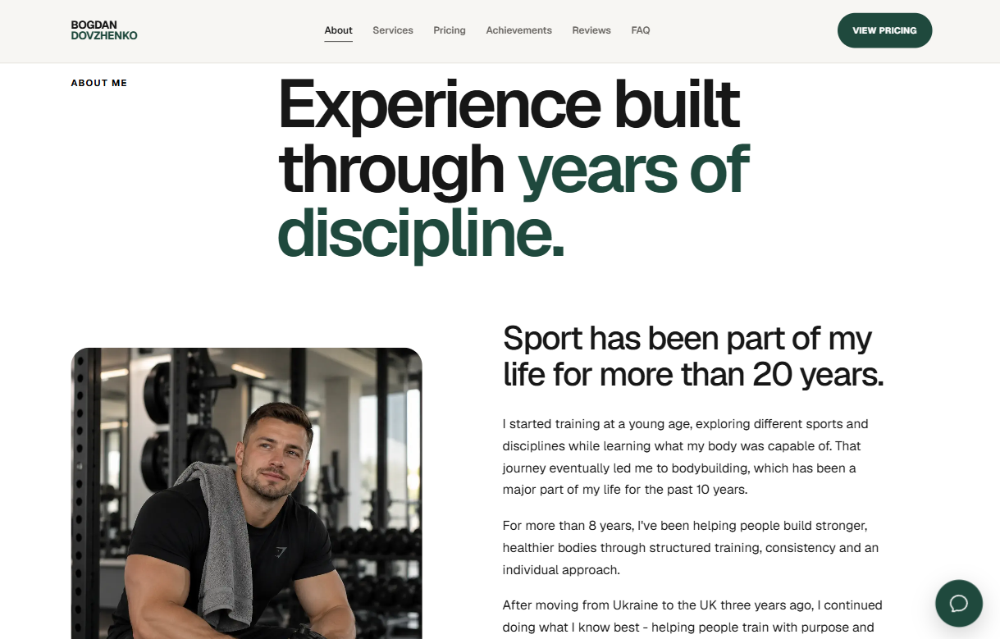
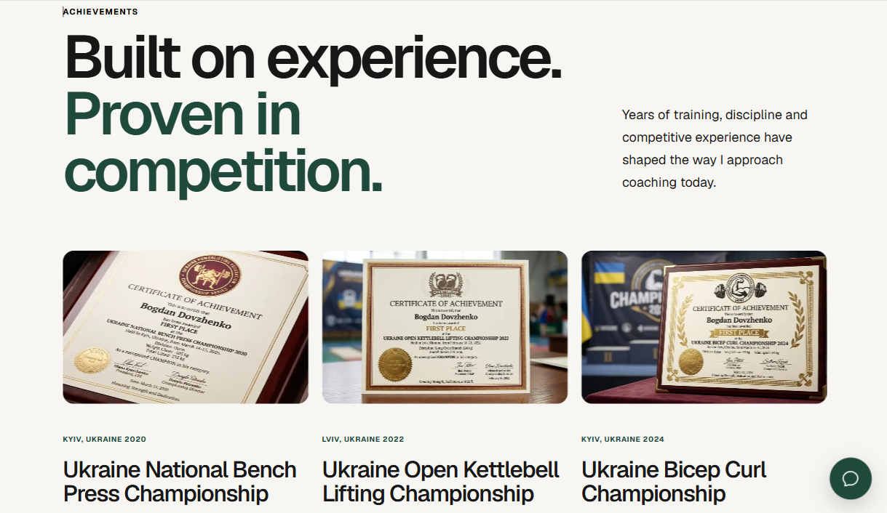
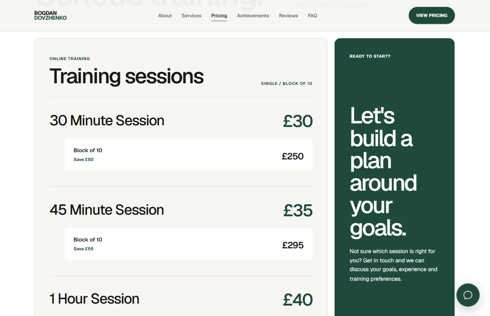
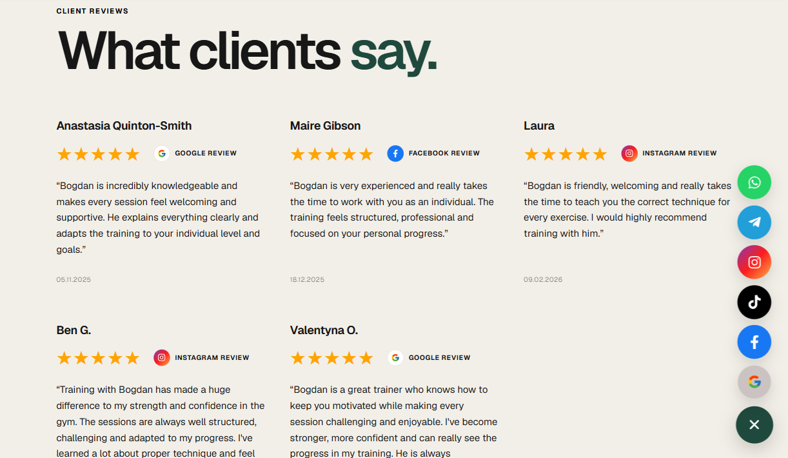

# 💪 Bogdan Dovzhenko — Personal Trainer & Online Coach

A modern, fully responsive personal trainer portfolio website built with **Next.js**, **React**, **TypeScript**, and **CSS**.

The website presents Bogdan's coaching experience, training services, pricing, achievements, and client reviews through a clean, easy-to-navigate interface. Developed with a **mobile-first approach**, the design adapts to **mobile, tablet, and desktop** screens.

## 🌐 Live Demo

👉 [https://online-coach-uk.vercel.app/](https://online-coach-uk.vercel.app/)

### About

An introduction to Bogdan's background, experience in sport and coaching, and his approach to helping clients reach their fitness goals.

### Achievements

A dedicated section highlighting sporting achievements and certificates.

### Pricing

A clear overview of personal training sessions and available training packages, helping visitors explore their options.

### Reviews

A responsive review section designed to present client feedback in an easy-to-read layout.

## ✨ Features

- 📱 Mobile-first responsive design for mobile, tablet, and desktop
- 🧭 Sticky navigation and smooth section scrolling
- 🍔 Responsive mobile navigation menu
- 💪 Personal trainer introduction and coaching philosophy
- 🎯 Training goals and services overview
- 💷 Clear personal training prices and packages
- 🏆 Achievements and certificates section
- ⭐ Client review cards with platform labels
- ❓ Expandable FAQ section
- 💬 Interactive social/contact menu
- 🔗 Social media and contact links
- 🖼️ Optimised WebP images
- 🎨 Custom BD favicon
- 🚀 Deployment on Vercel

## 🛠 Tech Stack

- Next.js (App Router)
- React
- TypeScript
- CSS3
- Responsive Web Design
- CSS Grid
- Flexbox
- React Icons
- WebP image optimisation
- Vercel

## 💡 What I Built

During this project I worked on:

- Planning and developing a personal trainer portfolio website from scratch
- Designing a clean, modern interface focused on usability
- Building the website with a **mobile-first approach**
- Adapting layouts for **tablet and desktop** screen sizes
- Creating responsive navigation with a mobile menu
- Developing sections for About, Goals, Services, Pricing, Achievements, Reviews, and FAQ
- Presenting training packages and pricing clearly
- Creating a responsive layout for certificates and reviews
- Building an expandable FAQ using native HTML elements
- Implementing an interactive social/contact menu
- Adding smooth navigation between page sections
- Optimising images using WebP
- Creating a custom **BD** favicon
- Deploying the website with Vercel

## 📁 Repository

👉 [https://github.com/JenyaLinx/online-coach-uk](https://github.com/JenyaLinx/online-coach-uk)

---

## 👨‍💻 Author

**Yevhenii Oliinyk**

GitHub: [https://github.com/JenyaLinx](https://github.com/JenyaLinx)

LinkedIn: [https://www.linkedin.com/in/yevhenii-oliinykk](https://www.linkedin.com/in/yevhenii-oliinykk)
